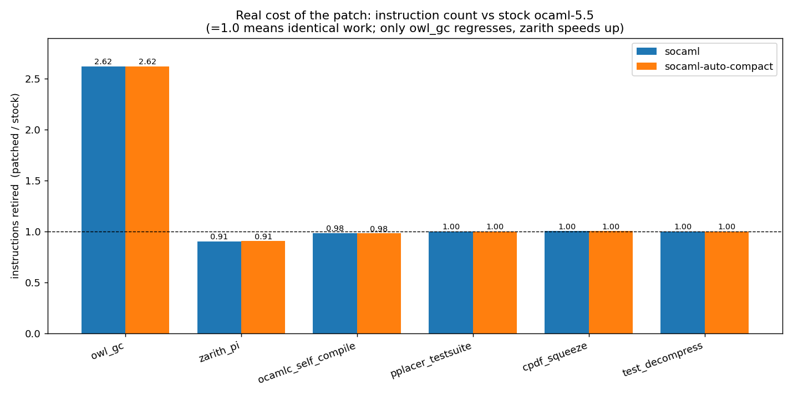
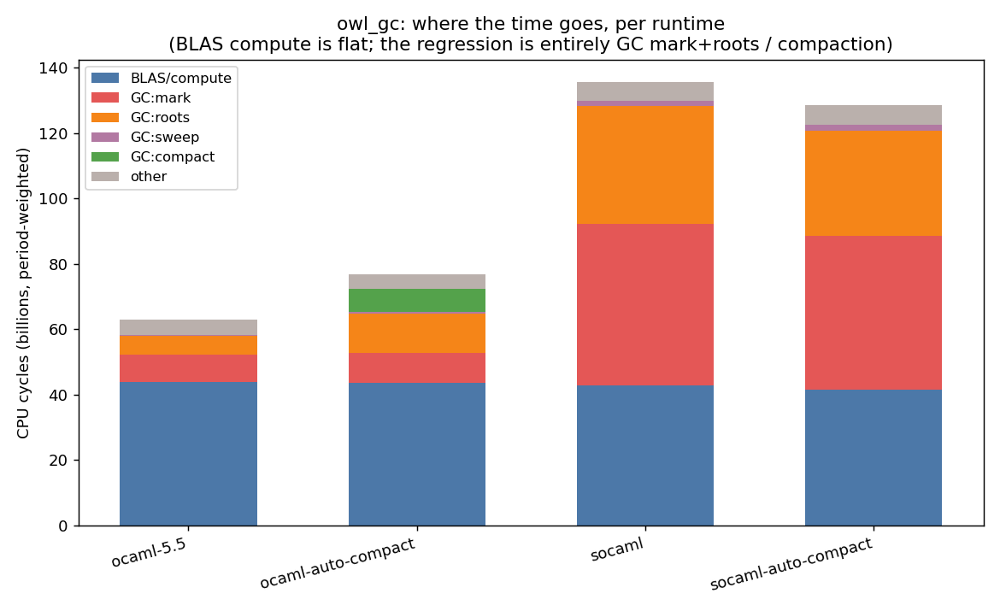

# TASK 2 — perf-based root-cause of runtime slowdowns: results

**Question (PLAN.md TASK 2):** what actually causes the benchmark slowdowns
on the patched runtimes (auto-compaction, chunk allocator), down to 2% and
below, and is there an overlapping cost fixable in the patch?

**Answer in one line:** of every slowdown ever reported for these runtimes,
**only `owl_gc` is real** — and it is one mechanism (a Bigarray custom-block
GC trigger firing ~8× too often on the chunk allocator, plus a fully
`O=`-tunable auto-compaction cost). Every other reported slowdown (pplacer,
eio, ocamlc, cpdf, liq_video) is noise at the instruction level; `zarith_pi`
is a real speedup.

Full method + per-phase detail: `worklog.md`. Plan: `../../../pplacer-workdir/TASK2-PLAN.md`.

## Method

Each runtime's benchmark `.exe` (not-stripped, full DWARF) run **directly**
under `perf record --call-graph dwarf,16384 --all-user -F 999` (3 reps),
plus one `perf stat` (PMU counters) and `strace -c` per cell. Args/env
mirror `macro_base.yml`. `taskset -c 3` + `setarch -R` for stability.
Flamegraphs and **differential** flamegraphs via brendangregg/FlameGraph.

Two methodology facts that matter (Phase 0):
- **DWARF, not frame pointers** — OCaml native code omits FP, so FP
  call-graphs break at the OCaml↔C boundary; DWARF (`.eh_frame`) is correct.
- **`perf script --no-inline`** — the default DWARF inline resolver hangs
  (>90 s vs 0.09 s) on these 31 MB binaries.
- `perf stat` (PMU counters) is authoritative for per-runtime totals;
  folded stacks (period-weighted) for within-profile attribution.

## The real cost of the patch (instructions vs stock, = honest "extra work")



| benchmark | socaml | socaml-auto-compact | ocaml-auto-compact | wall verdict |
|---|---|---|---|---|
| **owl_gc** | **2.62×** | **2.62×** | **1.28×** | **real slowdown** |
| zarith_pi | 0.91× | 0.91× | ~1.0× | **real speedup (−16%)** |
| ocamlc_self_compile | 0.98× | 0.98× | ~1.0× | noise (claim +12% ✗) |
| pplacer_testsuite | 1.00× | 1.00× | ~1.0× | noise (claim +2% ✗) |
| cpdf_squeeze | 1.00× | 1.00× | ~1.0× | noise (claim +1.5% ✗) |
| test_decompress | 1.00× | 1.00× | ~1.0× | flat |
| eio_fiber_stream | — | — | — | off-CPU; claim +22% ✗ (scheduling variance) |
| liq_video_frames_pool | — | — | — | exe not built; prior data flat ±2% |

`1.00×` means the chunk allocator adds **zero** instructions. eio is ~99.9%
off-CPU (fiber/io_uring wait) so `perf record` finds no hotspot — and its
+22% didn't reproduce (all runtimes within 4%).

## owl_gc — the one real slowdown, fully attributed



Subsystem CPU breakdown (period-weighted, millions; BLAS/compute — the
actual matmul — is **flat**, so the whole regression is GC):

| subsystem | ocaml-5.5 | ocaml-auto-compact | socaml | socaml-auto-compact |
|---|---|---|---|---|
| BLAS/compute | 43,724 | 43,674 | 42,821 | 41,449 |
| GC:mark | 8,550 | 9,055 | **49,263 (5.8×)** | 47,005 |
| GC:roots | 5,651 | 12,099 (2.1×) | **36,132 (6.4×)** | 32,402 |
| GC:compact | 0 | **7,207** | 0 | 0 |

`perf stat`: socaml **2.62× instructions**, IPC *rises* (3.34→4.05),
cache-references *fall* (0.68×), page-faults 2.57×, `strace` mmaps *fewer*
(103 vs 126). So it is **more work, not worse memory behaviour or syscalls**.

### Mechanism (differential flamegraph, dominant socaml stack)

```
owl matmul → caml_ba_create → caml_ba_alloc → caml_alloc_custom_mem
  → alloc_custom_gen → caml_check_urgent_gc → …STW…
    → caml_scan_global_roots     +    caml_major_collection_slice → do_some_marking
```

owl's matrices are **Bigarray custom blocks with off-heap memory**;
`caml_alloc_custom_mem`'s dependent-memory accounting forces GC as off-heap
bytes accumulate. On the chunk allocator this trigger fires **~8× more
often** — weight under `alloc_custom_gen→caml_check_urgent_gc` goes from
**13.2% of all CPU (stock) to 53.0% (socaml)** — matching TASK 1's
olly-measured **5.5× more collections**. The per-firing cost
(`caml_scan_global_roots`, fixed per STW cycle, + marking) then scales
linearly. `ocaml-auto-compact`'s smaller +28% is the compaction itself
(`GC:compact`) plus the root-rescan compaction induces, at the `O=500`
default where owl compacts ~100% of cycles for ~0 RSS gain.

## zarith_pi — the real win, mechanism refined

−16% wall. `perf stat`: **cache-references 0.25×, page-faults 0.40×**,
instructions 0.91×, IPC 2.58→2.79. The chunk allocator's win for zarith's
extreme small-bignum churn is **memory locality + fewer first-touch faults**
from bulk 8 MB allocation — *not* mmap-syscall batching (syscalls only
36→21, negligible). This refines TASK 1's "batches mmap" summary.

## mmap batching: real, but almost always immaterial

The chunk allocator slashes mmap syscalls dramatically (ocamlc 30,563→216;
cpdf 8,735→55; pplacer 668→120) with **no wall-time or page-fault effect** —
pages still fault on first touch; the saved syscalls only matter when
allocation *is* the workload (zarith). This is why "fewer mmaps" does not
translate to "faster" anywhere but zarith.

## Recommendations

1. **Ship TASK 1's `O=` default change (500 → 700–1000).** The perf data
   confirms at the instruction level that it removes the entire
   `ocaml-auto-compact` owl regression (compaction + induced root-rescan)
   with no effect on any other benchmark. This is the one patch change TASK 2
   directly endorses.
2. **The chunk allocator's owl regression is a real compiler-side bug worth
   fixing but out of scope here:** it is precisely located — the chunk
   allocator perturbs the **custom-block dependent-memory GC pacing**
   (`caml_alloc_custom_mem` / `caml_custom_major_ratio` accounting vs. the
   chunk heap-size bookkeeping in `shared_heap.c`), causing ~8× excess GC
   cycles for Bigarray-heavy workloads. No runtime knob mitigates it
   (`O=`, chunk-size floor, and `o=` all shown inert for owl). This narrows
   TASK 1's open "opportunistic-slice pacing" question to the custom-mem
   trigger path specifically.
3. **No broad cross-benchmark overlap exists to fix** — because only owl
   regresses. The claimed pplacer/eio/ocamlc/cpdf slowdowns are not runtime
   costs and need no patch work.

## Artifacts

- `worklog.md` — 5 phases, all raw numbers.
- `capture.sh`, `fold_and_plot.sh`, `subsys.py`, `stat_table.py`,
  `plot_results.py` — the harness (reusable for any bench/runtime).
- `flamegraphs/*.svg` — per-cell + differential flamegraphs for every cell.
- `stat/`, `strace/`, `perf-data/` — raw captures.
- `plots/instruction_ratio.png`, `plots/owl_subsystem.png`.
- `FlameGraph/` — vendored tooling.
