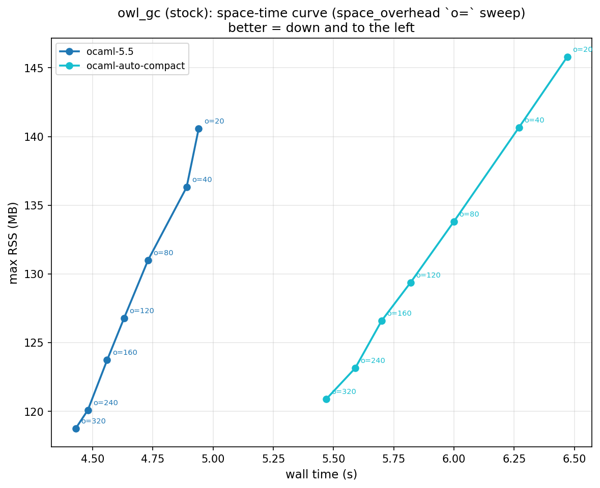
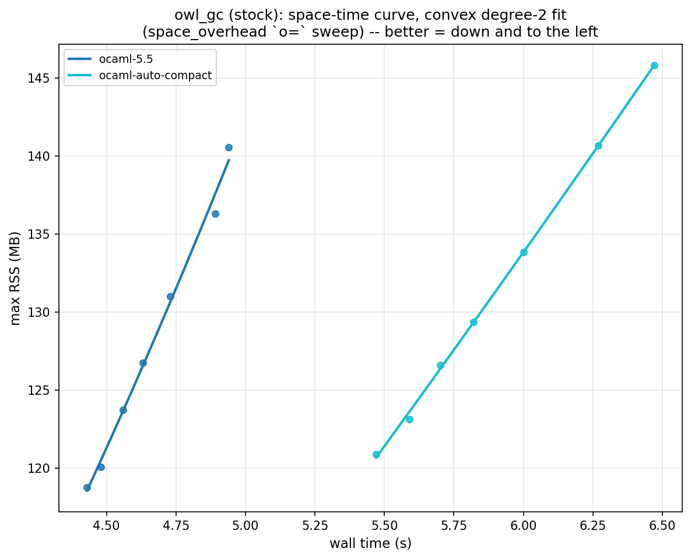
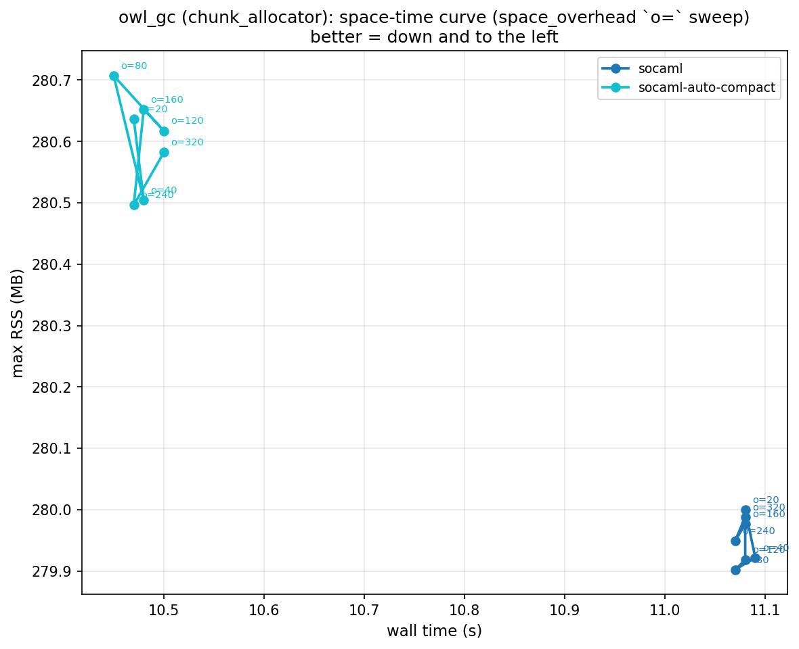
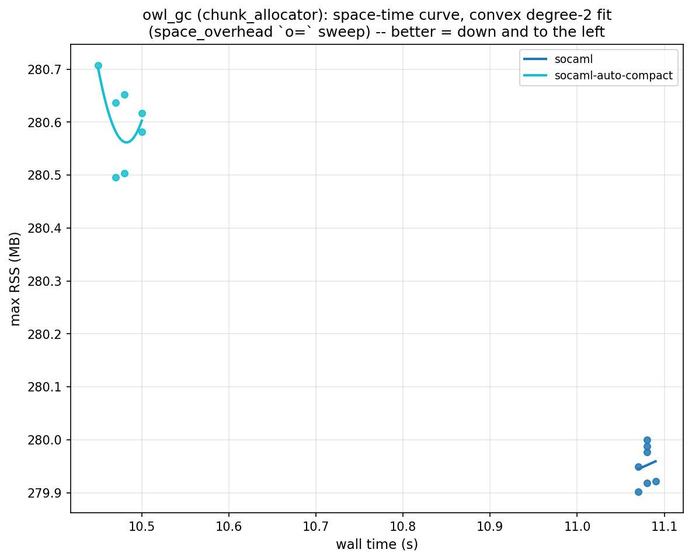
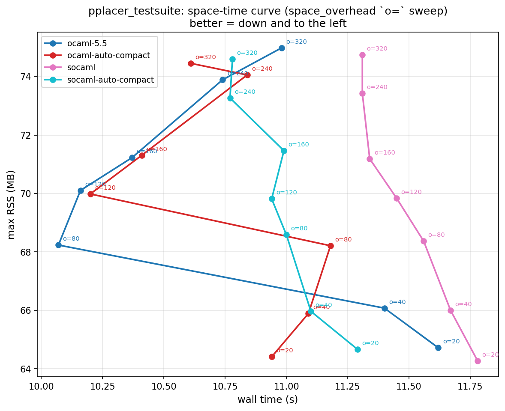
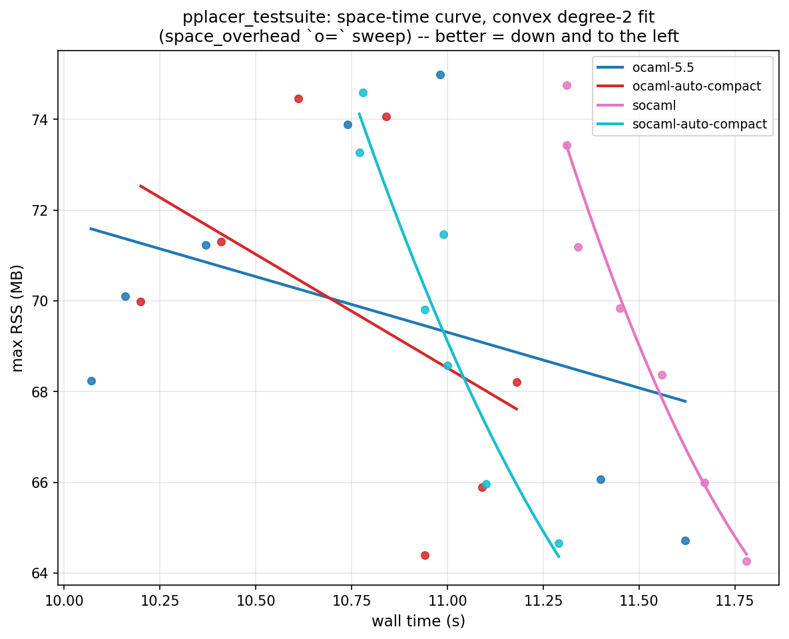

# Space-time curve: is the new GC better or worse?

Methodology: Jane Street, ["Memory Allocator Showdown"](https://blog.janestreet.com/memory-allocator-showdown/).
Sweep OCaml's `space_overhead` runtime parameter (`OCAMLRUNPARAM o=`,
`caml_percent_free`, default 120 — **not** the `O=` auto-compact threshold
used throughout the rest of this investigation, a completely separate
knob) and plot max RSS (y) against wall time (x) for each runtime (the
post itself plots the opposite way round; ours is swapped by request).
Each
`o=` value is one point; connecting them in sweep order traces a curve.
Per the post: **better = down and to the left** (faster and smaller for
the same knob setting); a curve that sits strictly above/right of another
is strictly worse, no matter which point on it you pick.

Config: `src/running/config/experiments/space_time_curve_o_sweep.yml`.
`o = [20, 40, 80, 120, 160, 240, 320]` (brackets the true default 120, the
same way the post brackets its own default) × `{ocaml-5.5, ocaml-auto-
compact, socaml, socaml-auto-compact}`, 5 invocations. Benchmarks:
`owl_gc` and `pplacer_testsuite`, the suite's two highest-GC-overhead
benchmarks (see `auto-compact-tuning/worklog.md` Phase 9) and therefore
the two most likely to show a real space/time tradeoff at all — most
benchmarks in the suite have too little GC overhead for `o=` to move
anything. Run id `lovelace-2026-09-08-Tue-165623`.

Plots/tables: `plots/space_time_curve_{owl_gc,pplacer_testsuite}*.{png,txt}`
(the `.txt` also has the average/median/range summary across `o=` per
runtime). Each benchmark also has a `space_time_curve_fit_*.png`: the same
axes and data, but instead of connecting the raw `o=` points with straight
segments (which zig-zags wherever a point is noisy — see `pplacer_
testsuite` below), it fits a degree-2 least-squares polynomial (`RSS =
f(wall_time)`) per runtime, **constrained convex** (leading coefficient
>= 0 — a real tradeoff frontier bows one consistent way, it doesn't arc up
then back down; if the unconstrained fit would be concave, it falls back
to the best-fit straight line instead, which is convex in the degenerate
sense), and draws that curve, with the raw points scattered underneath for
reference. `owl_gc`'s two runtime clusters (stock vs. chunk-allocator
variants) sit ~2.3x apart on both axes, so plotting all four together
squashes the stock pair into a corner — its plots are split into
`_stock`/`_chunk_allocator` files, each auto-scaled to its own cluster;
`pplacer_testsuite`'s four runtimes overlap enough to stay on one shared
plot.

## owl_gc — clear verdict: the new GC is worse, and the knob doesn't fix it

| runtime | wall avg | wall range | RSS avg | RSS range |
|---|---|---|---|---|
| ocaml-5.5 | 4.666s | 0.510s | 128.2 MB | 21.8 MB |
| ocaml-auto-compact | 5.903s | 1.000s | 131.5 MB | 24.9 MB |
| socaml | 11.079s | 0.020s | 280.0 MB | 0.1 MB |
| socaml-auto-compact | 10.479s | 0.050s | 280.6 MB | 0.2 MB |

- **`socaml`/`socaml-auto-compact` sit in a completely different part of
  the plane**: ~2.3x the wall time and ~2.2x the RSS of stock, at *every*
  `o=` value. There is no `o=` setting where the new GC comes anywhere
  close to stock's curve — the two clusters don't overlap at all.
- **The new-GC cluster is also nearly a single point, not a curve**: RSS
  range across the whole 20-320 sweep is 0.1-0.2 MB (vs. 22-25 MB for the
  stock/auto-compact runtimes) — `space_overhead` has essentially zero
  effect once the chunk allocator is in play. Its convex fit
  (`_chunk_allocator` plot) is visibly just chasing sub-MB noise at that
  scale — not a meaningful curve, which is itself the finding. This matches
  `auto-compact-tuning/worklog.md`'s Phase 1 finding #2: the RSS/time
  blowup here is the chunk allocator's 8MB-granularity pool interacting
  badly with `owl_gc`'s Bigarray/OpenBLAS allocation profile (5.5x more
  minor+major collections than stock), a structural effect independent of
  any GC pacing knob — `O=` doesn't move it (Phase 7) and now `o=`
  doesn't either.
- **Within the stock/auto-compact pair, both curves are real, sloped
  tradeoff curves** (the classic shape: more RSS bought back as less
  time) — `ocaml-5.5`'s curve sits entirely below-left of
  `ocaml-auto-compact`'s, i.e. auto-compaction is a strict, if modest,
  regression for this benchmark at every `o=` (it's still compacting
  heavily at the compiled-in `O=500` default; consistent with the whole
  auto-compact-tuning investigation's headline finding).
- **Conclusion for `owl_gc`: the new GC is unambiguously worse by this
  metric** — worse on both axes simultaneously, and un-tunable via the
  one knob this methodology sweeps.

## pplacer_testsuite — noisier, smaller effect, same direction

The convex fit makes the `pplacer_testsuite` pattern much easier to read
than the raw zig-zag. `ocaml-5.5` and `ocaml-auto-compact`'s unconstrained
fits both wanted to arc up then back down (concave) — rejected by the
convexity constraint, so both fall back to their best-fit straight line
instead, gently decreasing across 10.1-11.6s. `socaml` and `socaml-auto-
compact` both keep a real convex (bowl-up) curve, and both sit visibly
right of the two lines: `socaml`'s curve spans 11.3-11.8s with almost no
overlap with the stock pair, `socaml-auto-compact`'s spans 10.8-11.3s,
overlapping only at its leftmost edge.

| runtime | wall avg | wall range | RSS avg | RSS range |
|---|---|---|---|---|
| ocaml-5.5 | 10.763s | 1.550s | 69.9 MB | 10.3 MB |
| ocaml-auto-compact | 10.753s | 0.980s | 69.8 MB | 10.1 MB |
| socaml | 11.489s | 0.470s | 69.7 MB | 10.5 MB |
| socaml-auto-compact | 10.981s | 0.520s | 69.8 MB | 9.9 MB |

- Much less separation than `owl_gc`: all four runtimes land in the same
  64-75 MB / 10-12s region, and none of the four curves is monotonic —
  5 invocations isn't enough to fully average out this benchmark's
  wall-time noise (its GC overhead is enormous, ~80%, but flat regardless
  of runtime or `O=`, per Phase 9 — the noise is pre-existing, not new).
- **Still, a real pattern survives the noise**: `socaml` (pink) sits
  strictly above every other runtime's curve for `o= <= 160` — worse wall
  time at equal-or-lower RSS — before converging with the pack at
  `o=240-320`. `socaml-auto-compact` sits between stock and plain
  `socaml` for most of the range. `ocaml-5.5` and `ocaml-auto-compact` are
  essentially indistinguishable here (unlike `owl_gc`, pplacer's
  auto-compaction cost was already known to be small — Phase 3 measured
  it within ±5.2%).
- **Conclusion for `pplacer_testsuite`: mildly worse for the new GC, but
  nowhere near as decisive as `owl_gc`** — the chunk allocator's RSS cost
  doesn't show up here (pplacer's smaller/different allocation profile
  doesn't trigger it), and the small wall-time cost that remains is close
  to this benchmark's own noise floor.

## Overall

Across the two benchmarks where a space-time tradeoff is visible at all,
**the new GC (chunk allocator, with or without auto-compaction) does not
show a better space-time curve than stock — it shows either a much worse
one (`owl_gc`) or a mildly worse, noisier one (`pplacer_testsuite`)**, and
in neither case does `space_overhead` give it a way to buy back the
difference. This is consistent with, and adds a second lens to,
`auto-compact-tuning/worklog.md`'s existing conclusion that the chunk
allocator's benefit is workload-specific (a real win for `zarith_pi`'s
allocation-churn profile, per the compactor-comparison results) rather
than a general improvement — on these two GC-heavy benchmarks it's a
regression, and that regression is invisible to the one knob this
methodology is built to explore.
