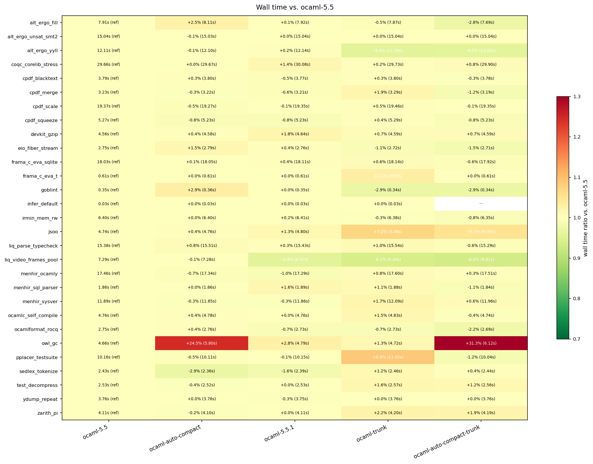
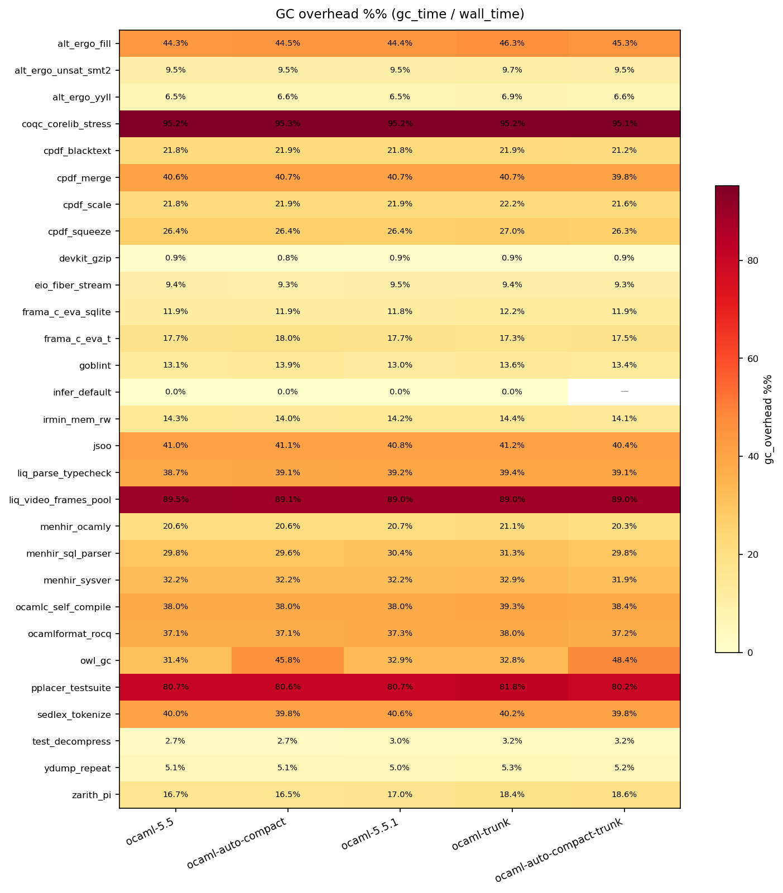
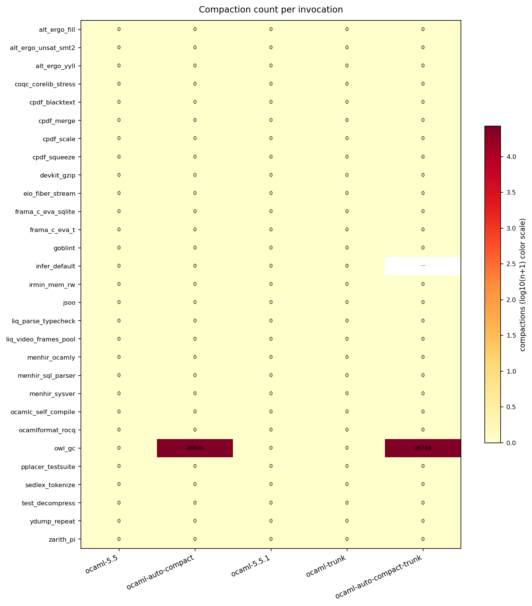
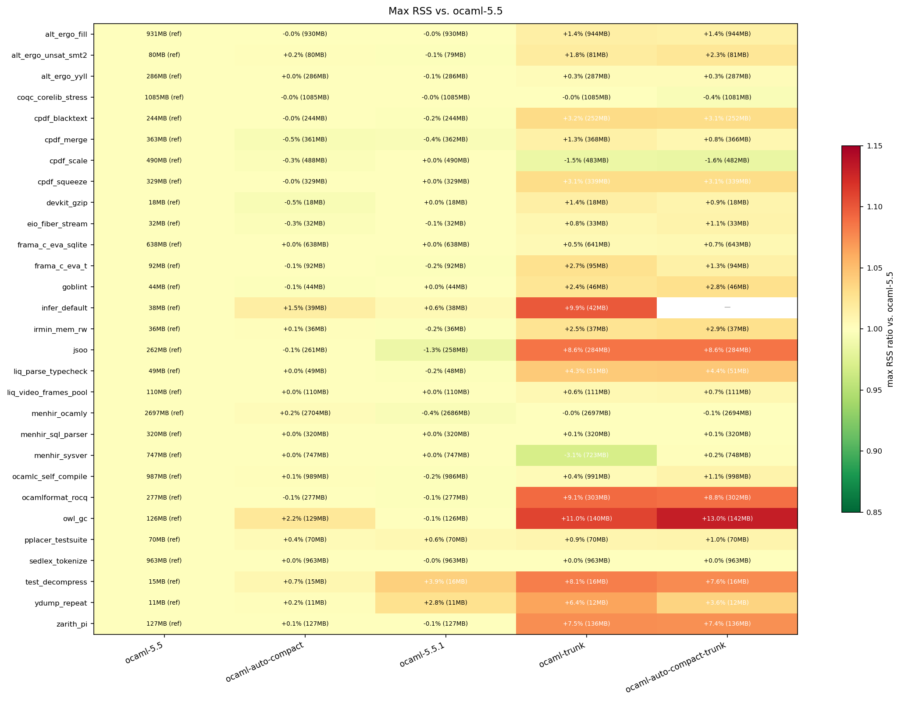

# 5.5 vs. 5.5.1 vs. trunk, with/without automatic compaction (fixed re-run)

Re-run of `../trunk-auto-compact-comparison/` after fixing the ppxlib/trunk
build gap that left 12/29 benchmarks unbuildable on both trunk runtimes
(see `worklog.md` for the root cause and fix). Same 5 runtimes, full
macro-benches suite, 3 invocations. Coverage: **29/29 on `ocaml-5.5`,
`ocaml-auto-compact`, `ocaml-5.5.1`, `ocaml-trunk`; 28/29 on
`ocaml-auto-compact-trunk`** (only `infer_default` still excluded there,
a narrow `ocamlfind`/opam-switch limitation of the `executable:` runtime
mode, unrelated to the ppxlib fix -- see `worklog.md`). Up from 17/29 on
both trunk runtimes before the fix.

Plots/tables: `plots/full/` (`heatmap_{wall_time_ratio,max_rss_ratio,
gc_overhead_pct,compactions}.png`, `wall_time_table.txt`,
`max_rss_table.txt`, `summary_stats.txt`).

## The rebase is validated again, now with full coverage

`owl_gc` compacts **26,745** times on `ocaml-auto-compact-trunk` vs.
**26,806** on the original `ocaml-auto-compact` (5.5.0) patch -- a 0.2%
difference, identical to the partial-coverage run. Auto-compaction's cost
reproduces at closely matching magnitude on both lineages:

| runtime | owl_gc wall time | owl_gc GC overhead | owl_gc RSS |
|---|---|---|---|
| ocaml-5.5 | 4.66s (ref) | 31.4% | 126MB (ref) |
| ocaml-auto-compact | +24.5% (5.80s) | 45.8% | +2.2% (129MB) |
| ocaml-5.5.1 | +2.8% (4.79s, no auto-compact) | 32.9% | -0.1% (126MB) |
| ocaml-trunk | +1.3% (4.72s, no auto-compact) | 32.8% | +11.0% (140MB) |
| ocaml-auto-compact-trunk | +31.3% (6.12s) | 48.4% | +13.0% (142MB) |

The `auto-compact-tuning` recommendation (raise the compiled-in default
`O=` from 500 to 700-1000) transfers to trunk unchanged -- nothing about
the mechanism moved.

## GC overhead

Unchanged from the partial run's read: `owl_gc` is the only benchmark
whose GC overhead responds to auto-compaction at all (both lineages), and
`pplacer_testsuite` (~80-82%) / `liq_video_frames_pool` (~89%) /
`coqc_corelib_stress` (~95%) remain the suite's highest-overhead
benchmarks, flat across every runtime -- large, real GC costs entirely
unrelated to compaction or version freshness.

## Compactions

Now with full 28/29 (was 17/29) coverage on `ocaml-auto-compact-trunk`:
confirmed **`owl_gc` is the only benchmark in the entire suite that ever
compacts**, on either auto-compact lineage. Raising the default cannot
newly start or stop compacting anything else.

## Version-freshness RSS creep -- confirmed as a real, broad effect

With full coverage, the version-freshness RSS effect flagged tentatively
in the partial run is now clearly a *broad*, consistent pattern rather
than a handful of coincidences: **10 of 29 benchmarks show a
+2.4% to +13.0% RSS increase on both `ocaml-trunk` and
`ocaml-auto-compact-trunk` roughly equally** -- `owl_gc` (+11.0%/+13.0%),
`ocamlformat_rocq` (+9.1%/+8.8%), `jsoo` (+8.6%/+8.6%), `test_decompress`
(+8.1%/+7.6%), `zarith_pi` (+7.5%/+7.4%), `ydump_repeat` (+6.4%/+3.6%),
`liq_parse_typecheck` (+4.3%/+4.4%), `cpdf_blacktext`/`cpdf_squeeze`
(+3.1-3.2%), `goblint` (+2.4%/+2.8%), `frama_c_eva_t` (+2.7%/+1.3%),
`irmin_mem_rw` (+2.5%/+2.9%). Present almost identically on *both* trunk
columns (with and without auto-compact), confirming it's trunk drifting
from 5.5.0 generally, not an auto-compaction interaction. `infer_default`
shows the same effect on stock `ocaml-trunk` alone (+9.9%, the only data
point available for it there). Not chased further here -- out of scope for
this investigation, but worth flagging for anyone tracking trunk memory
regressions.

## Conclusion

Fixing the ppxlib build gap didn't change any conclusion from the partial
run -- it just replaced "plausible based on 17/29 benchmarks" with
"confirmed on 28-29/29." The auto-compact-tuning investigation's findings
and recommendation hold on trunk with full-suite confidence, and the
version-freshness RSS creep (a separate, real phenomenon) is now clearly
a broad pattern rather than a few noisy benchmarks.
